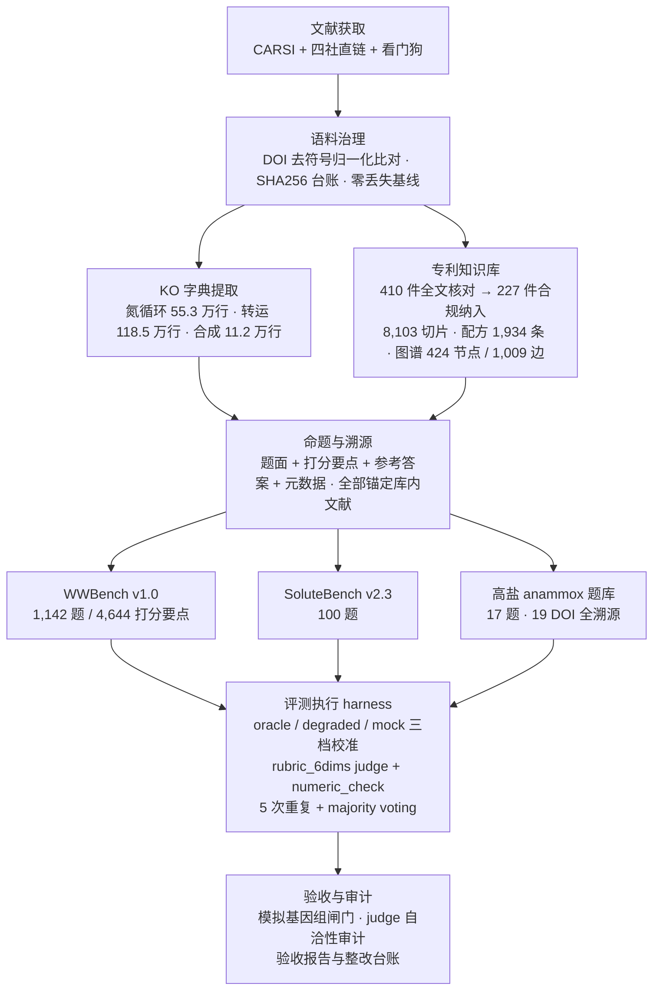

# Agent for Pollution

**面向废水生物处理的 LLM 智能体评测基准与领域知识库**（高盐 anammox / 相容性溶质方向） · PKU

通用科学智能体基准（如 BixBench）尚未覆盖废水生物处理这一高度专业化的领域：没有领域题库，没有真实基因组附件，更没有对每道题、每条知识的溯源要求。本仓库针对这一空白，沿"文献获取 → 领域知识构建 → 基准命题 → 评测执行 → 验收审计"的完整链路交付了一套可复现资产：**1,142 题的领域评测基准 WWBench、100 题的 SoluteBench、185 万行 KO 命中字典、227 件合规专利构成的 RAG 知识库与配方图谱，以及贯穿全程的 QA 门禁记录**。每一项交付物均可从仓库内的脚本、台账与报告出发逐步复现。

## Pipeline Overview



## Benchmark

### WWBench v1.0 — 废水生物处理领域评测基准

WWBench 是一个面向**高盐废水 anammox 与相容性溶质调控**的领域评测框架，在形式上对标 BixBench（FutureHouse，[arXiv:2503.00096](https://arxiv.org/abs/2503.00096)），但在三个维度上做了领域化改造：

| 维度 | BixBench | WWBench |
|---|---|---|
| 数据载体 | capsule（数据 + notebook） | 结构化题库：题面 + 6 维打分要点 + 参考答案 + 元数据 |
| 智能体 | Aviary 脚手架，3 工具 | solver 单轮 / agent 模式（run_python · read_file · list_workdir · submit_answer） |
| 环境 | 每题独立 Docker | 每题独立工作区，`data/attachments/<qid>/**` 自动分发 |
| 判分 | LLM judge + 双轨校验 | rubric_6dims LLM judge + numeric_check 数值容差校验 |
| 重复 | 5 次重复 + majority voting | 同口径，另附投票数–准确率曲线的精确二项计算 |

- **题库规模**（v1.0.1 实测口径）：1,142 题 / 4,644 个打分要点；题型 6 类；难度分布 复杂 637 / 中等 441 / 简单 64；主题覆盖 anammox 高盐耐受、相容性溶质调控、耐盐化工措施等
- **专家金标准**：专家撰写的 52 题金标准随包发布（`WWBench_v1.0/dataset/questions-verified-52.csv`）
- **真实基因组附件**：3 个 anammox MAG 全基因组随基准分发，供智能体在题内实际调用分析——
  - *Candidatus* Scalindua sp. AMX11（GCA_004351875.1）
  - *Candidatus* Kuenenia stuttgartiensis sp. HKUEN01（GCA_022180985.1）
  - *Candidatus* Brocadia sinica sp. MAG_7（GCA_013360995.1）
- **三档离线校准基线**（无需 API key）：满分上界 oracle `mean_score 0.942` / 半分档 degraded50 `0.525` / 弱模型 mock `0.053`——评测系统的判别力在部署真实模型之前即可量化
- **配套审计工具**：`audit_dataset.py`（题库模板契合 + 完整性）、`audit_judges.py`（judge 自洽性 / 交叉 kappa / 顺序偏差）、`compare_runs.py`（多 run 排行榜与分组柱状图）；离线冒烟测试 `tests/test_smoke.py` 一键验证数据、提示词、判分、智能体与数值校验全流程
- **消融与稳健性设计**：closed vs with_refs 消融、拒答识别、断点续跑、轨迹与工作区落盘

评测框架的完整方法论、与 BixBench 的逐项对照及整改验收记录见 `WWBench_v1.0/harness/README.md` 与根目录《Bench测评复盘报告》《WWBench_v1.1_整改台账与验收报告》。

### SoluteBench v2.3 与高盐 anammox 题库

| 题库 | 规模 | 命题纪律 |
|---|---|---|
| SoluteBench v2.3（`SoluteBench_v2.3_100题.csv`） | 100 题 | 相容性溶质主题，题题溯源 |
| 高盐 anammox 评测题库（`高盐厌氧氨氧化AI智能体评测试题_20260927.csv`） | 17 题（q-201–217） | 全部锚定库内 19 个 DOI 文献，命题管线（digest → 命题 → 评审）见 `qa_gen/` |

命题遵循零捏造纪律：题面、参考答案与打分要点必须能回溯到具体文献或专利原文，无法核验的内容显式标注而非含糊带过。

## Domain Knowledge Base

### KO 字典提取（氮循环 / 转运 / 合成）

以 64 个 KO 条目（v2 字典）为查询集合，对 KEGG 环境基因注释库执行同源检索，交付三类命中行字典：

| 字典 | 规模 | 说明 |
|---|---|---|
| 氮循环 KO 命中行 | 553,000 行 | 含过程标注（每行可映射到氮循环具体过程） |
| 相容性溶质转运 KO 命中行 | 1,185,000 行 | 含 transDB 注释，env/ench 双库合并 |
| 相容性溶质合成合并表 | 112,000 行 | 三源合并 |

提取、QA 与回归测试全流程脚本随附于 `task/交付_Nitrogen_CompSul_20261014/scripts/`，QA 全绿后交付；大体积命中行表以压缩归档入库（`KO命中行合并TSV_压缩备份_20261104.zip`）。

### 专利知识库（compatible solute）

以 `"compatible solute"` 精确检索式从 Google Patents 采集 410 件专利全文，经逐件全文合规核验（中英日德法西多语种原文核对"相容性溶质"术语，剔除 13 件同形异义），最终 **227 件合规纳入**，并在此语料上构建：

| 资产 | 规模 | 关键设计 |
|---|---|---|
| 系统性综述 | 1 份（六章，Nature 综述体例） | 全部结论锚定专利原文，跨专利概括显式标注"基于专利文本的归纳" |
| RAG 知识库 | 8,103 个自包含切片 | 个体滑窗（1,500 字符）+ 科学主题二级索引；权利要求 / 实施例 / 背景技术三级信息标注，防止把背景技术误读为本专利效果 |
| 配方数据库 | 1,934 条 × 12 字段 | 物质–场景–浓度/配比–量化效果四元组，覆盖 193 件专利，每条含原文锚点 |
| GraphRAG 图谱 | 424 节点 / 1,009 边 | Patent–Applicant–Solute–IPC 四类节点、5 种关系，边含 evidence 列 |
| 跨语言重写器 | 8 语种 | 中英日德法西葡 + 布尔检索式，供跨语种检索 |

每条切片携带 15 字段元数据（专利号、日期、申请人、IPC、溶质标签、SHA256、字符偏移等），`analysis/grounding_records.json` 保留每件专利的逐条溯源记录（短语上下文摘录 + 主题标签）。交付说明、方法摘要与人工复核过程见 `patents/产出/README.md` 与《合规校验与知识库质量自检报告》。

### 文献获取管线

面向订阅墙文献的自动下载器（`literature_downloader/`）：CARSI 机构登录 + 四大出版商直链 + 看门狗进程守护，队列清单与缺口台账（`missing_*.csv` / `remaining*.csv`）随仓库交付；与既有 PDF 库的比对采用 DOI 去符号归一化，基线零丢失。可移植工具包另见 `lit-toolkit/`。

## Validation & QA

工程纪律只有一条：**没有 QA 记录的交付不算交付**。

- **模拟基因组验证闸门**：人工构造 mock genome，从基因预测、KO 注释到下游分析全流程真跑，验证闸门 100% 通过（`task/交付_模拟验证与三场景接入/`）
- **三场景接入验证**：16S 扩增子 / MAG / 用户自备输入三条分析链路统一入口真跑验证，输出与指标逐项核对
- **QA 记录**：KO 提取 QA 全绿；丰度与环境条件框架 QA 48/48；模拟验证与三场景接入 QA 30/30；专利 OCR 补齐 16 项对账闭环
- **基准自身被审计**：judge 自洽性（kappa）、题库完整性、三档校准判别力均在真实评测前完成校准，复盘与整改台账全文收录

## Repository Layout

```
.
├── WWBench_v1.0/                  # 领域评测基准
│   ├── dataset/                   #   questions.csv（v1.0.1）+ 52 题专家金标准
│   ├── harness/                   #   运行框架：runner / agent / graders / metrics / configs / tests
│   ├── docs/  results/            #   方法文档与结果汇总
├── patents/                       # 专利知识库
│   ├── 产出/                       #   综述 / RAG 知识库 / 配方库 / 图谱 / QA 报告 / 管线代码
│   └── analysis/                  #   溯源记录与合规校验证据
├── task/                          # 历次任务交付
│   ├── 交付_Nitrogen_CompSul_20261014/     #   KO 字典提取（脚本 + QA + 压缩归档）
│   ├── 交付_对用户输入数据进行分析/          #   MAG 注释丰度 + 丰度与环境条件框架
│   ├── 交付_模拟验证与三场景接入/            #   mock genome 验证 + 三场景统一入口 + 经验库
│   └── 2CompSul/                  #   相容性溶质字典输入
├── qa_gen/                        # 命题管线：digest → 命题 → 评审
├── literature_downloader/         # 订阅库自动下载器（CARSI + 直链 + 看门狗）
├── lit-toolkit/                   # 可移植文献工具包
├── OmicOS-BixBench-main/          # 参考评测框架（BixBench 变体）
├── 10.20/                         # 会议记录与汇报材料
└── *.md                           # 评测复盘 / 整改台账 / 验收报告
```

## Getting Started

环境要求：Python 3.10+，依赖见 `WWBench_v1.0/harness/requirements.txt`（pandas ≥ 2.0、PyYAML ≥ 6.0、openai ≥ 1.30、matplotlib ≥ 3.7）。

```bash
# 离线冒烟测试：数据、提示词、判分、智能体、数值校验全流程（无需 API key）
python WWBench_v1.0/harness/tests/test_smoke.py

# 三档离线校准基线
python WWBench_v1.0/harness/scripts/run_bench.py --config WWBench_v1.0/harness/configs/run_oracle.yaml
python WWBench_v1.0/harness/scripts/run_bench.py --config WWBench_v1.0/harness/configs/run_oracle_degraded.yaml
python WWBench_v1.0/harness/scripts/run_bench.py --config WWBench_v1.0/harness/configs/run_mock.yaml

# 题库体检与 judge 自洽性审计
python WWBench_v1.0/harness/scripts/audit_dataset.py
python WWBench_v1.0/harness/scripts/audit_judges.py --config WWBench_v1.0/harness/configs/run_oracle.yaml --repeats 3
```

专利知识库构建管线（PDF → TXT → 合规校验 → 人工裁定 → 切片 → 校验）见 `patents/产出/README.md` 与 `patents/产出/scripts/`。

## Data Availability

- 基因组附件：3 个 anammox MAG 已随基准分发，原始数据可经 NCBI 按 GCA 登录号获取
- 专利语料：410 件 PDF 直链与 SHA256 记录于 `patents/patent_pdf_download_status.csv`，可按单重下
- 超大中间产物（原始字典扫描 TSV 约 19.8 GB、专利 PDF 语料约 502 MB）不入库；KO 命中行最终交付表以 `KO命中行合并TSV_压缩备份_20261104.zip` 归档

## Citation

```bibtex
@misc{agentforpollution2026,
  title  = {Agent for Pollution: 面向废水生物处理的 LLM 智能体评测基准与领域知识库},
  author = {SCIENCE-FRESHMEN},
  year   = {2026},
  url    = {https://github.com/SCIENCE-FRESHMEN/agent-for-pollution}
}
```

## Contact

PKU · 环境微生物组方向。评测框架方法论问题优先查阅 `WWBench_v1.0/harness/README.md`；专利知识库方法细节查阅 `patents/产出/README.md`。
