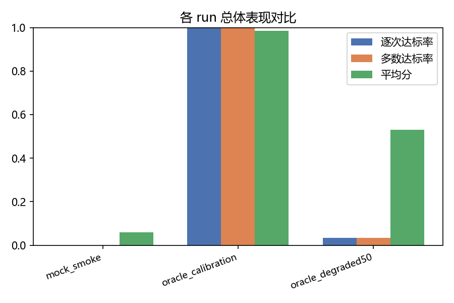

# WWBench 多 run 对比

| run                | 模型   | 模式   |   平均分 |   逐次达标率 |   多数达标率 |   拒答率 |   数值召回 |   要点覆盖率 |
|:-------------------|:-------|:-------|---------:|-------------:|-------------:|---------:|-----------:|-------------:|
| mock_smoke         | mock   | single |   0.0596 |        0     |        0     |   0.1042 |     0.2045 |       0.0653 |
| oracle_calibration | oracle | single |   0.984  |        1     |        1     |   0      |     1      |       0.9842 |
| oracle_degraded50  | oracle | single |   0.5312 |        0.035 |        0.035 |   0      |     0.5847 |       0.5763 |

