# WWBench 评测报告

生成时间:2026-09-24T23:50:09

## 1. 题库概览

- 题目数:1142,打分要点总数:4644(平均 4.07/题)
- 难度分布:{'复杂': 637, '中等': 441, '简单': 64}
- 题型分布:{'T1 总体耐盐化措施': 442, 'E 环境工程/能源': 223, 'T7 培养基设计': 143, 'A 盐度-主导溶质': 123, 'T5 菌株选择': 116, 'T10 场景推理': 95}
- 因子设计轴(题面解析):优势菌 {'(非T1)': 700, 'Anammoxoglobus': 103, 'Jettenia': 98, 'Kuenenia': 82, 'Scalindua': 81, 'Brocadia': 78};盐度区间 {'(非T1)': 700, '1%→3%': 46, '1%→5%': 42, '2%→4%': 41, '0.5%→3%': 40, '0.5%→2%': 38, '1%→2%': 38, '1.5%→5.5%': 35, '2.5%→5%': 35, '3%→6%': 34, '2%→6%': 33, '0.5%→1.5%': 32, '1.5%→4%': 28}

## 2. 运行配置

- 求解模型:`mock`,复跑次数:2,上下文模式:closed
- 评分器:`heuristic`,通过阈值:0.6

## 3. 总体指标

- 评测覆盖:期望 1142 题,实际评测 1142 题,缺失 0 题,未知题号 0 个

| 指标 | 值 |
|---|---|
| 平均综合分 | 0.0534 |
| 逐次达标率 (accuracy) | 0.0 |
| accuracy Wilson 95% CI | {'low': 0.0, 'high': 0.0017} |
| 多数达标率 (stable, majority-vote 口径) | 0.0 |
| stable Wilson 95% CI | {'low': 0.0, 'high': 0.0034} |
| 拒答率 | 0.1042 |
| 非拒答作答平均分 (precision 口径) | 0.0596 |
| 要点覆盖率 | 0.0653 |
| 六维归一分 | 0.0415 |
| 数值召回(容差校验5%内) | 0.2045 |

六维明细:
- accuracy: 0.0749
- completeness: 0.0749
- mechanism: 0.0123
- feasibility: 0.0749
- evidence: 0.0
- rigor: 0.0123

## 按标签分层

| 标签     |   题数 |   平均分 |   逐次达标率 |   多数达标率 |   拒答率 |
|:---------|-------:|---------:|-------------:|-------------:|---------:|
| 脱氮     |   1026 |   0.0528 |            0 |            0 |   0.1053 |
| 污泥     |     80 |   0.0839 |            0 |            0 |   0.1125 |
| 厌氧消化 |     36 |   0.002  |            0 |            0 |   0.0556 |

## 按主题分层

| 主题           |   题数 |   平均分 |   逐次达标率 |   多数达标率 |   拒答率 |
|:---------------|-------:|---------:|-------------:|-------------:|---------:|
| 环境工程与能源 |    757 |   0.0091 |            0 |            0 |   0.1044 |
| 微生物调控     |    262 |   0.163  |            0 |            0 |   0.0916 |
| 高盐胁迫       |    123 |   0.0925 |            0 |            0 |   0.1301 |

## 按难度分层

| 难度   |   题数 |   平均分 |   逐次达标率 |   多数达标率 |   拒答率 |
|:-------|-------:|---------:|-------------:|-------------:|---------:|
| 复杂   |    637 |   0.0084 |            0 |            0 |   0.1068 |
| 中等   |    441 |   0.1122 |            0 |            0 |   0.0998 |
| 简单   |     64 |   0.0957 |            0 |            0 |   0.1094 |

## 按题型分层

| 题型              |   题数 |   平均分 |   逐次达标率 |   多数达标率 |   拒答率 |
|:------------------|-------:|---------:|-------------:|-------------:|---------:|
| T1 总体耐盐化措施 |    442 |   0.0108 |            0 |            0 |   0.1222 |
| E 环境工程/能源   |    223 |   0.0096 |            0 |            0 |   0.0852 |
| T7 培养基设计     |    143 |   0.0988 |            0 |            0 |   0.0769 |
| A 盐度-主导溶质   |    123 |   0.0925 |            0 |            0 |   0.1301 |
| T5 菌株选择       |    116 |   0.2464 |            0 |            0 |   0.1121 |
| T10 场景推理      |     95 |   0      |            0 |            0 |   0.0632 |

## 按细分分层

| 细分         |   题数 |   平均分 |   逐次达标率 |   多数达标率 |   拒答率 |
|:-------------|-------:|---------:|-------------:|-------------:|---------:|
| 废水生物处理 |   1140 |   0.0535 |            0 |            0 |   0.1044 |
| 其他         |      2 |   0      |            0 |            0 |   0      |

## 按优势菌分层

| 优势菌         |   题数 |   平均分 |   逐次达标率 |   多数达标率 |   拒答率 |
|:---------------|-------:|---------:|-------------:|-------------:|---------:|
| (非T1)         |    700 |   0.0803 |            0 |            0 |   0.0929 |
| Anammoxoglobus |    103 |   0.0049 |            0 |            0 |   0.0971 |
| Jettenia       |     98 |   0.0061 |            0 |            0 |   0.1531 |
| Kuenenia       |     82 |   0.0136 |            0 |            0 |   0.122  |
| Scalindua      |     81 |   0.0164 |            0 |            0 |   0.1358 |
| Brocadia       |     78 |   0.0156 |            0 |            0 |   0.1026 |

## 按目标盐度分层

| 目标盐度   |   题数 |   平均分 |   逐次达标率 |   多数达标率 |   拒答率 |
|:-----------|-------:|---------:|-------------:|-------------:|---------:|
| (非T1)     |    700 |   0.0803 |            0 |            0 |   0.0929 |
| 3%         |     86 |   0.0117 |            0 |            0 |   0.1047 |
| 5%         |     77 |   0.0158 |            0 |            0 |   0.1169 |
| 2%         |     76 |   0.0173 |            0 |            0 |   0.1974 |
| 4%         |     69 |   0.0176 |            0 |            0 |   0.0725 |
| 6%         |     67 |   0      |            0 |            0 |   0.1045 |
| 5.5%       |     35 |   0      |            0 |            0 |   0.1429 |
| 1.5%       |     32 |   0      |            0 |            0 |   0.125  |

## 按基因组档案分层

| 基因组档案            |   题数 |   平均分 |   逐次达标率 |   多数达标率 |   拒答率 |
|:----------------------|-------:|---------:|-------------:|-------------:|---------:|
| (非T1)                |    700 |   0.0803 |            0 |            0 |   0.0929 |
| Jettenia-P8.fna       |     19 |   0.0158 |            0 |            0 |   0.0526 |
| Jettenia-P5.fna       |     19 |   0.0105 |            0 |            0 |   0.0526 |
| Anammoxoglobus-P4.fna |     17 |   0      |            0 |            0 |   0      |
| Scalindua-P8.fna      |     15 |   0      |            0 |            0 |   0.0667 |
| Kuenenia-P3.fna       |     14 |   0.0214 |            0 |            0 |   0.0714 |
| Anammoxoglobus-P7.fna |     14 |   0.0071 |            0 |            0 |   0      |
| Kuenenia-P6.fna       |     14 |   0.0583 |            0 |            0 |   0.1429 |
| Brocadia-P2.fna       |     14 |   0.0071 |            0 |            0 |   0.1429 |
| Anammoxoglobus-P2.fna |     14 |   0.0143 |            0 |            0 |   0.1429 |
| Anammoxoglobus-P3.fna |     14 |   0      |            0 |            0 |   0.0714 |
| Anammoxoglobus-P1.fna |     13 |   0      |            0 |            0 |   0.1538 |
| Kuenenia-P5.fna       |     13 |   0      |            0 |            0 |   0      |
| Jettenia-P6.fna       |     13 |   0      |            0 |            0 |   0.1538 |
| Jettenia-P4.fna       |     13 |   0      |            0 |            0 |   0.2308 |
| Anammoxoglobus-P8.fna |     13 |   0      |            0 |            0 |   0.1538 |
| Brocadia-P7.fna       |     12 |   0.025  |            0 |            0 |   0.0833 |
| Kuenenia-P7.fna       |     12 |   0      |            0 |            0 |   0.1667 |
| Scalindua-P2.fna      |     11 |   0      |            0 |            0 |   0.2727 |
| Jettenia-P3.fna       |     11 |   0.0091 |            0 |            0 |   0.2727 |
| Scalindua-P3.fna      |     11 |   0      |            0 |            0 |   0.0909 |
| Brocadia-P4.fna       |     11 |   0.0742 |            0 |            0 |   0.0909 |
| Brocadia-P8.fna       |     11 |   0      |            0 |            0 |   0.0909 |
| Scalindua-P4.fna      |     10 |   0.0408 |            0 |            0 |   0.1    |
| Scalindua-P6.fna      |     10 |   0.0817 |            0 |            0 |   0      |
| Kuenenia-P4.fna       |      9 |   0      |            0 |            0 |   0      |
| Scalindua-P1.fna      |      9 |   0.0111 |            0 |            0 |   0.3333 |
| Scalindua-P7.fna      |      9 |   0      |            0 |            0 |   0.1111 |
| Anammoxoglobus-P5.fna |      9 |   0.0222 |            0 |            0 |   0.2222 |
| Kuenenia-P1.fna       |      9 |   0      |            0 |            0 |   0.2222 |
| Anammoxoglobus-P6.fna |      9 |   0      |            0 |            0 |   0.1111 |
| Jettenia-P7.fna       |      9 |   0      |            0 |            0 |   0.2222 |
| Kuenenia-P8.fna       |      8 |   0      |            0 |            0 |   0.25   |
| Jettenia-P1.fna       |      8 |   0      |            0 |            0 |   0.25   |
| Brocadia-P5.fna       |      8 |   0      |            0 |            0 |   0      |
| Brocadia-P3.fna       |      8 |   0      |            0 |            0 |   0.125  |
| Brocadia-P6.fna       |      7 |   0      |            0 |            0 |   0      |
| Brocadia-P1.fna       |      7 |   0      |            0 |            0 |   0.2857 |
| Jettenia-P2.fna       |      6 |   0      |            0 |            0 |   0.1667 |
| Scalindua-P5.fna      |      6 |   0      |            0 |            0 |   0.1667 |
| Kuenenia-P2.fna       |      3 |   0      |            0 |            0 |   0.3333 |

## 按类别标签(多标签)分层

| 类别标签                      |   题数 |   平均分 |   逐次达标率 |   多数达标率 |   拒答率 |
|:------------------------------|-------:|---------:|-------------:|-------------:|---------:|
| Activated sludge              |     34 |   0      |            0 |            0 |   0.1471 |
| Aerobic granular sludge       |      2 |   0      |            0 |            0 |   0      |
| Ammonia inhibition            |     16 |   0      |            0 |            0 |   0.125  |
| Anaerobic digestion           |     35 |   0.002  |            0 |            0 |   0.0571 |
| Anammox                       |    610 |   0.0696 |            0 |            0 |   0.1164 |
| Bioaugmentation               |    618 |   0.0541 |            0 |            0 |   0.1165 |
| Compatible solutes            |    922 |   0.0606 |            0 |            0 |   0.1128 |
| Denitrification               |     19 |   0.0154 |            0 |            0 |   0      |
| EPS                           |     37 |   0      |            0 |            0 |   0.1622 |
| Halomonas                     |     22 |   0      |            0 |            0 |   0.0909 |
| MBR                           |     18 |   0      |            0 |            0 |   0.1667 |
| Mainstream                    |      1 |   0      |            0 |            0 |   1      |
| Membrane fouling              |     18 |   0      |            0 |            0 |   0.1667 |
| Methanogenesis                |     18 |   0      |            0 |            0 |   0      |
| N2O mitigation                |     18 |   0.0162 |            0 |            0 |   0      |
| Nitrification                 |     42 |   0.0619 |            0 |            0 |   0.0952 |
| PN/A                          |     66 |   0.0032 |            0 |            0 |   0.0455 |
| Partial denitrification       |     24 |   0.099  |            0 |            0 |   0      |
| SRB competition               |     15 |   0      |            0 |            0 |   0      |
| Salinity acclimation          |    699 |   0.0239 |            0 |            0 |   0.103  |
| Salt shock                    |     33 |   0.003  |            0 |            0 |   0.1515 |
| Sulfate                       |     15 |   0      |            0 |            0 |   0      |
| Sulfur-driven denitrification |     25 |   0.0117 |            0 |            0 |   0.08   |
| Temperature                   |     16 |   0      |            0 |            0 |   0.0625 |
| Thauera                       |     23 |   0.1033 |            0 |            0 |   0      |
| Wastewater treatment          |     35 |   0.0024 |            0 |            0 |   0.0571 |
| 场景推理                      |     95 |   0      |            0 |            0 |   0.0632 |
| 培养基设计                    |    143 |   0.0988 |            0 |            0 |   0.0769 |
| 工艺决策                      |     15 |   0      |            0 |            0 |   0      |
| 总体策略                      |    442 |   0.0108 |            0 |            0 |   0.1222 |
| 污泥处置                      |     16 |   0      |            0 |            0 |   0.125  |
| 环境工程-污泥                 |      6 |   0      |            0 |            0 |   0      |
| 环境工程-能源                 |     19 |   0.0038 |            0 |            0 |   0      |
| 环境工程-脱氮                 |     70 |   0.0294 |            0 |            0 |   0.0714 |
| 盐度-主导溶质                 |    123 |   0.0925 |            0 |            0 |   0.1301 |
| 经济性                        |     17 |   0      |            0 |            0 |   0.1176 |
| 菌株选择                      |    116 |   0.2464 |            0 |            0 |   0.1121 |

## 优势菌 × 目标盐度交互

| 优势菌         | 目标盐度   |   题数 |   平均分 |   逐次达标率 |   多数达标率 |
|:---------------|:-----------|-------:|---------:|-------------:|-------------:|
| (非T1)         | (非T1)     |    700 |   0.0803 |            0 |            0 |
| Anammoxoglobus | 1.5%       |      7 |   0      |            0 |            0 |
| Anammoxoglobus | 2%         |     19 |   0.0053 |            0 |            0 |
| Anammoxoglobus | 3%         |     19 |   0.0105 |            0 |            0 |
| Anammoxoglobus | 4%         |     13 |   0.0154 |            0 |            0 |
| Anammoxoglobus | 5%         |     25 |   0      |            0 |            0 |
| Anammoxoglobus | 5.5%       |      6 |   0      |            0 |            0 |
| Anammoxoglobus | 6%         |     14 |   0      |            0 |            0 |
| Brocadia       | 1.5%       |      6 |   0      |            0 |            0 |
| Brocadia       | 2%         |     12 |   0.0167 |            0 |            0 |
| Brocadia       | 3%         |     17 |   0.0059 |            0 |            0 |
| Brocadia       | 4%         |      9 |   0.0454 |            0 |            0 |
| Brocadia       | 5%         |     11 |   0.0462 |            0 |            0 |
| Brocadia       | 5.5%       |     12 |   0      |            0 |            0 |
| Brocadia       | 6%         |     11 |   0      |            0 |            0 |
| Jettenia       | 1.5%       |      5 |   0      |            0 |            0 |
| Jettenia       | 2%         |     10 |   0.02   |            0 |            0 |
| Jettenia       | 3%         |     17 |   0.0059 |            0 |            0 |
| Jettenia       | 4%         |     21 |   0.0048 |            0 |            0 |
| Jettenia       | 5%         |     18 |   0.0111 |            0 |            0 |
| Jettenia       | 5.5%       |     10 |   0      |            0 |            0 |
| Jettenia       | 6%         |     17 |   0      |            0 |            0 |
| Kuenenia       | 1.5%       |      8 |   0      |            0 |            0 |
| Kuenenia       | 2%         |     24 |   0.017  |            0 |            0 |
| Kuenenia       | 3%         |     16 |   0.0318 |            0 |            0 |
| Kuenenia       | 4%         |      9 |   0.0111 |            0 |            0 |
| Kuenenia       | 5%         |      9 |   0.0111 |            0 |            0 |
| Kuenenia       | 5.5%       |      4 |   0      |            0 |            0 |
| Kuenenia       | 6%         |     12 |   0      |            0 |            0 |
| Scalindua      | 1.5%       |      6 |   0      |            0 |            0 |
| Scalindua      | 2%         |     11 |   0.0371 |            0 |            0 |
| Scalindua      | 3%         |     17 |   0.0059 |            0 |            0 |
| Scalindua      | 4%         |     17 |   0.024  |            0 |            0 |
| Scalindua      | 5%         |     14 |   0.0292 |            0 |            0 |
| Scalindua      | 5.5%       |      3 |   0      |            0 |            0 |
| Scalindua      | 6%         |     13 |   0      |            0 |            0 |

## 最难题目 Top10

| question_id   |   平均分 |   pass_rate |
|:--------------|---------:|------------:|
| q-061         |        0 |           0 |
| q-1000        |        0 |           0 |
| q-1001        |        0 |           0 |
| q-1002        |        0 |           0 |
| q-1003        |        0 |           0 |
| q-1004        |        0 |           0 |
| q-1005        |        0 |           0 |
| q-1006        |        0 |           0 |
| q-1007        |        0 |           0 |
| q-1008        |        0 |           0 |

## 最易题目 Top10

| question_id   |   平均分 |   pass_rate |
|:--------------|---------:|------------:|
| q-174         |   0.4083 |           0 |
| q-176         |   0.4083 |           0 |
| q-181         |   0.4083 |           0 |
| q-192         |   0.4083 |           0 |
| q-194         |   0.4083 |           0 |
| q-197         |   0.4083 |           0 |
| q-199         |   0.4083 |           0 |
| q-543         |   0.4083 |           0 |
| q-549         |   0.4083 |           0 |
| q-555         |   0.4083 |           0 |

## 图表

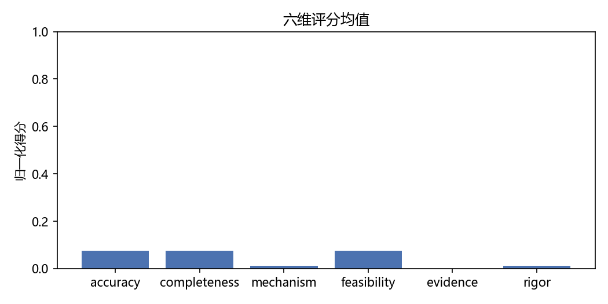
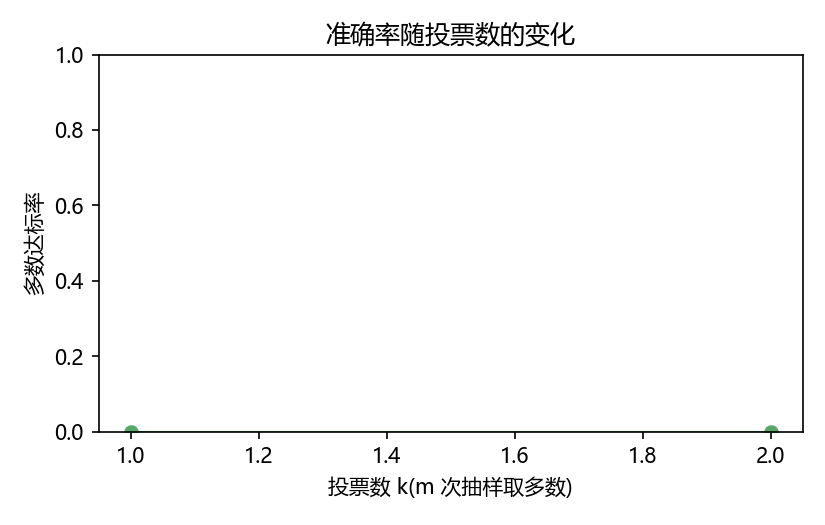
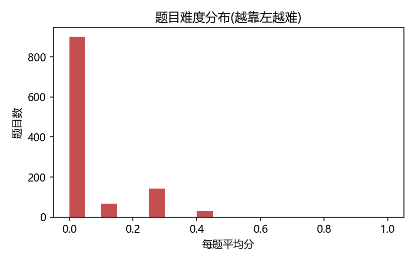
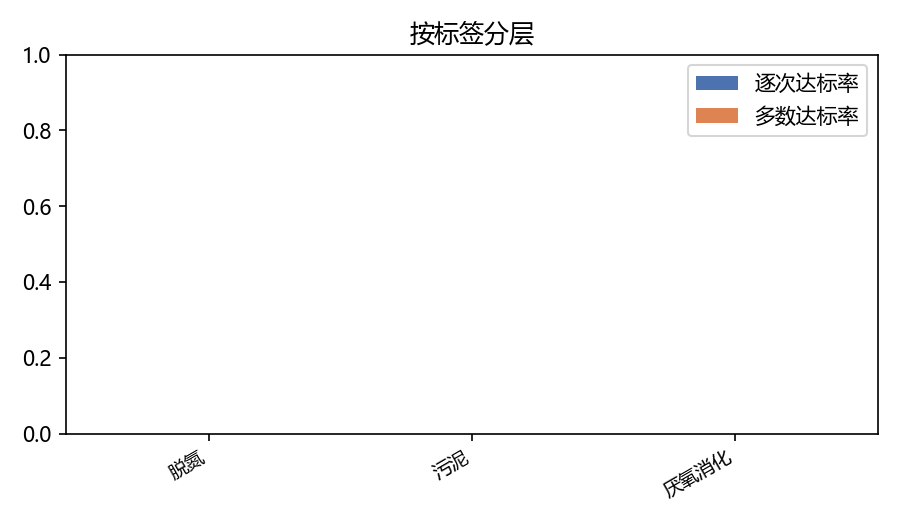
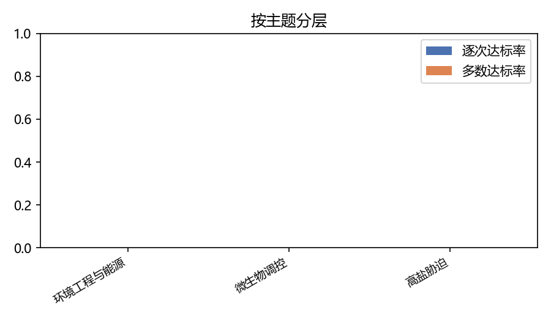
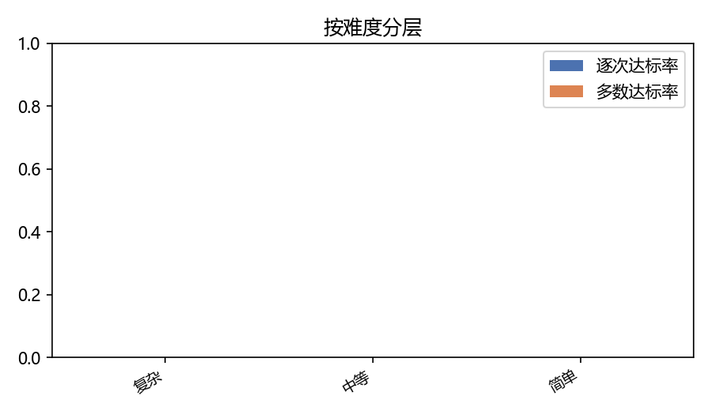
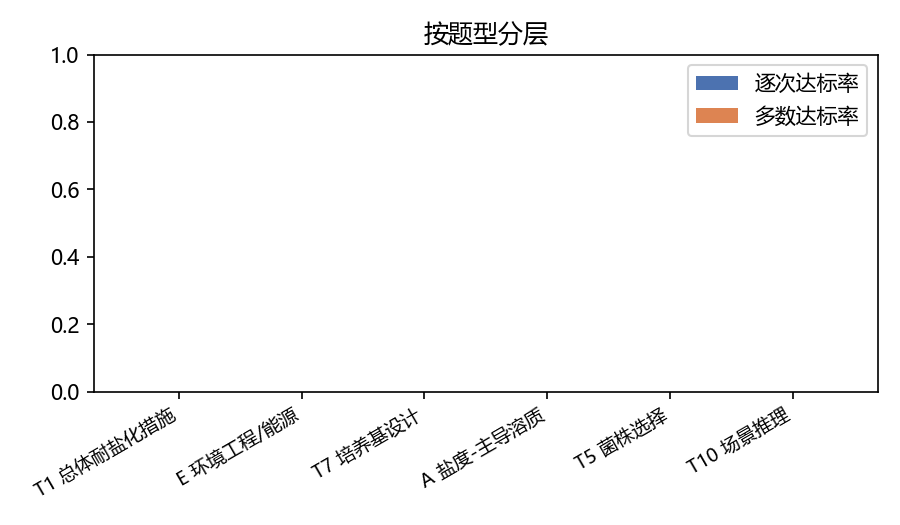
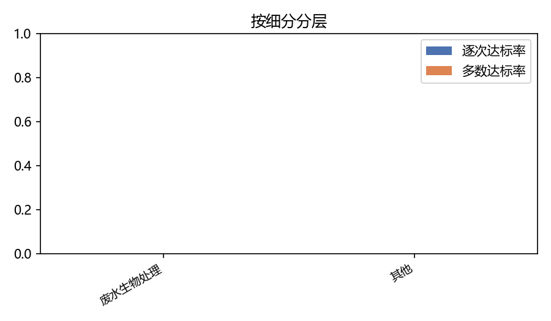
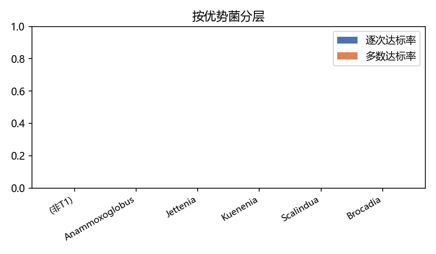
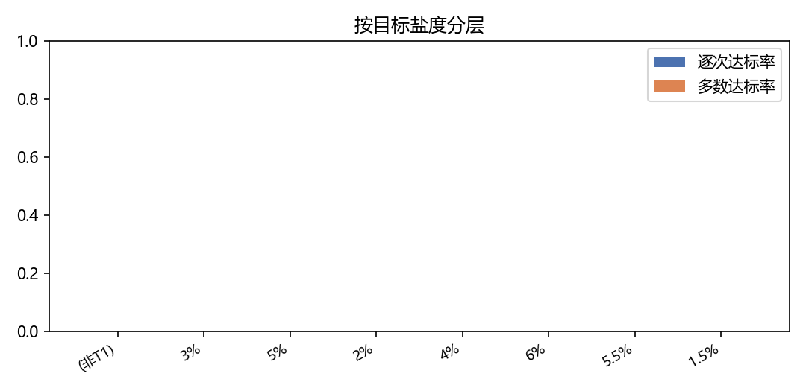
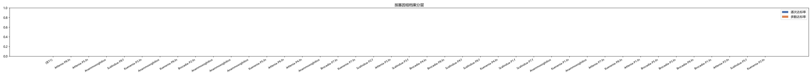
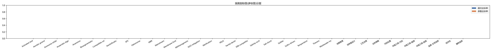
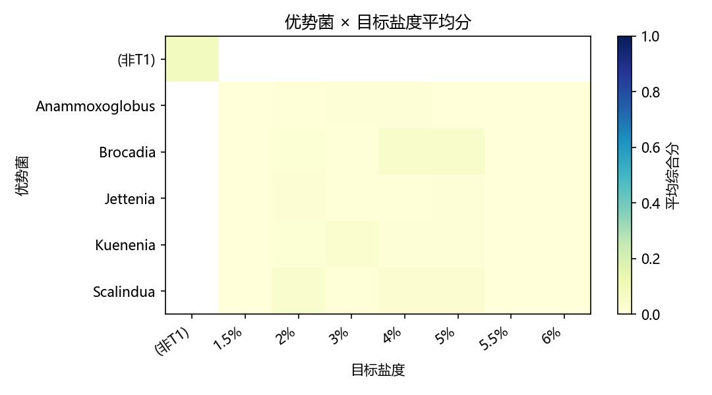