# WWBench 评测报告

生成时间:2026-09-24T23:49:58

## 1. 题库概览

- 题目数:1142,打分要点总数:4644(平均 4.07/题)
- 难度分布:{'复杂': 637, '中等': 441, '简单': 64}
- 题型分布:{'T1 总体耐盐化措施': 442, 'E 环境工程/能源': 223, 'T7 培养基设计': 143, 'A 盐度-主导溶质': 123, 'T5 菌株选择': 116, 'T10 场景推理': 95}
- 因子设计轴(题面解析):优势菌 {'(非T1)': 700, 'Anammoxoglobus': 103, 'Jettenia': 98, 'Kuenenia': 82, 'Scalindua': 81, 'Brocadia': 78};盐度区间 {'(非T1)': 700, '1%→3%': 46, '1%→5%': 42, '2%→4%': 41, '0.5%→3%': 40, '0.5%→2%': 38, '1%→2%': 38, '1.5%→5.5%': 35, '2.5%→5%': 35, '3%→6%': 34, '2%→6%': 33, '0.5%→1.5%': 32, '1.5%→4%': 28}

## 2. 运行配置

- 求解模型:`oracle`,复跑次数:2,上下文模式:closed
- 评分器:`heuristic`,通过阈值:0.6

## 3. 总体指标

- 评测覆盖:期望 1142 题,实际评测 1142 题,缺失 0 题,未知题号 0 个

| 指标 | 值 |
|---|---|
| 平均综合分 | 0.9423 |
| 逐次达标率 (accuracy) | 1.0 |
| accuracy Wilson 95% CI | {'low': 0.9983, 'high': 1.0} |
| 多数达标率 (stable, majority-vote 口径) | 1.0 |
| stable Wilson 95% CI | {'low': 0.9966, 'high': 1.0} |
| 拒答率 | 0.0 |
| 非拒答作答平均分 (precision 口径) | 0.9423 |
| 要点覆盖率 | 0.9842 |
| 六维归一分 | 0.9005 |
| 数值召回(容差校验5%内) | 1.0 |

六维明细:
- accuracy: 1.0
- completeness: 1.0
- mechanism: 0.9676
- feasibility: 0.9676
- evidence: 0.5
- rigor: 0.9676

## 按标签分层

| 标签     |   题数 |   平均分 |   逐次达标率 |   多数达标率 |   拒答率 |
|:---------|-------:|---------:|-------------:|-------------:|---------:|
| 脱氮     |   1026 |   0.9407 |            1 |            1 |        0 |
| 污泥     |     80 |   0.9583 |            1 |            1 |        0 |
| 厌氧消化 |     36 |   0.9528 |            1 |            1 |        0 |

## 按主题分层

| 主题           |   题数 |   平均分 |   逐次达标率 |   多数达标率 |   拒答率 |
|:---------------|-------:|---------:|-------------:|-------------:|---------:|
| 环境工程与能源 |    757 |   0.9422 |            1 |            1 |        0 |
| 微生物调控     |    262 |   0.9349 |            1 |            1 |        0 |
| 高盐胁迫       |    123 |   0.9583 |            1 |            1 |        0 |

## 按难度分层

| 难度   |   题数 |   平均分 |   逐次达标率 |   多数达标率 |   拒答率 |
|:-------|-------:|---------:|-------------:|-------------:|---------:|
| 复杂   |    637 |   0.9459 |            1 |            1 |        0 |
| 中等   |    441 |   0.9348 |            1 |            1 |        0 |
| 简单   |     64 |   0.9583 |            1 |            1 |        0 |

## 按题型分层

| 题型              |   题数 |   平均分 |   逐次达标率 |   多数达标率 |   拒答率 |
|:------------------|-------:|---------:|-------------:|-------------:|---------:|
| T1 总体耐盐化措施 |    442 |   0.9583 |            1 |            1 |        0 |
| E 环境工程/能源   |    223 |   0.9374 |            1 |            1 |        0 |
| T7 培养基设计     |    143 |   0.9168 |            1 |            1 |        0 |
| A 盐度-主导溶质   |    123 |   0.9583 |            1 |            1 |        0 |
| T5 菌株选择       |    116 |   0.9583 |            1 |            1 |        0 |
| T10 场景推理      |     95 |   0.8774 |            1 |            1 |        0 |

## 按细分分层

| 细分         |   题数 |   平均分 |   逐次达标率 |   多数达标率 |   拒答率 |
|:-------------|-------:|---------:|-------------:|-------------:|---------:|
| 废水生物处理 |   1140 |   0.9423 |            1 |            1 |        0 |
| 其他         |      2 |   0.9583 |            1 |            1 |        0 |

## 按优势菌分层

| 优势菌         |   题数 |   平均分 |   逐次达标率 |   多数达标率 |   拒答率 |
|:---------------|-------:|---------:|-------------:|-------------:|---------:|
| (非T1)         |    700 |   0.9322 |            1 |            1 |        0 |
| Anammoxoglobus |    103 |   0.9583 |            1 |            1 |        0 |
| Jettenia       |     98 |   0.9583 |            1 |            1 |        0 |
| Kuenenia       |     82 |   0.9583 |            1 |            1 |        0 |
| Scalindua      |     81 |   0.9583 |            1 |            1 |        0 |
| Brocadia       |     78 |   0.9583 |            1 |            1 |        0 |

## 按目标盐度分层

| 目标盐度   |   题数 |   平均分 |   逐次达标率 |   多数达标率 |   拒答率 |
|:-----------|-------:|---------:|-------------:|-------------:|---------:|
| (非T1)     |    700 |   0.9322 |            1 |            1 |        0 |
| 3%         |     86 |   0.9583 |            1 |            1 |        0 |
| 5%         |     77 |   0.9583 |            1 |            1 |        0 |
| 2%         |     76 |   0.9583 |            1 |            1 |        0 |
| 4%         |     69 |   0.9583 |            1 |            1 |        0 |
| 6%         |     67 |   0.9583 |            1 |            1 |        0 |
| 5.5%       |     35 |   0.9583 |            1 |            1 |        0 |
| 1.5%       |     32 |   0.9583 |            1 |            1 |        0 |

## 按基因组档案分层

| 基因组档案            |   题数 |   平均分 |   逐次达标率 |   多数达标率 |   拒答率 |
|:----------------------|-------:|---------:|-------------:|-------------:|---------:|
| (非T1)                |    700 |   0.9322 |            1 |            1 |        0 |
| Jettenia-P8.fna       |     19 |   0.9583 |            1 |            1 |        0 |
| Jettenia-P5.fna       |     19 |   0.9583 |            1 |            1 |        0 |
| Anammoxoglobus-P4.fna |     17 |   0.9583 |            1 |            1 |        0 |
| Scalindua-P8.fna      |     15 |   0.9583 |            1 |            1 |        0 |
| Kuenenia-P3.fna       |     14 |   0.9583 |            1 |            1 |        0 |
| Anammoxoglobus-P7.fna |     14 |   0.9583 |            1 |            1 |        0 |
| Kuenenia-P6.fna       |     14 |   0.9583 |            1 |            1 |        0 |
| Brocadia-P2.fna       |     14 |   0.9583 |            1 |            1 |        0 |
| Anammoxoglobus-P2.fna |     14 |   0.9583 |            1 |            1 |        0 |
| Anammoxoglobus-P3.fna |     14 |   0.9583 |            1 |            1 |        0 |
| Anammoxoglobus-P1.fna |     13 |   0.9583 |            1 |            1 |        0 |
| Kuenenia-P5.fna       |     13 |   0.9583 |            1 |            1 |        0 |
| Jettenia-P6.fna       |     13 |   0.9583 |            1 |            1 |        0 |
| Jettenia-P4.fna       |     13 |   0.9583 |            1 |            1 |        0 |
| Anammoxoglobus-P8.fna |     13 |   0.9583 |            1 |            1 |        0 |
| Brocadia-P7.fna       |     12 |   0.9583 |            1 |            1 |        0 |
| Kuenenia-P7.fna       |     12 |   0.9583 |            1 |            1 |        0 |
| Scalindua-P2.fna      |     11 |   0.9583 |            1 |            1 |        0 |
| Jettenia-P3.fna       |     11 |   0.9583 |            1 |            1 |        0 |
| Scalindua-P3.fna      |     11 |   0.9583 |            1 |            1 |        0 |
| Brocadia-P4.fna       |     11 |   0.9583 |            1 |            1 |        0 |
| Brocadia-P8.fna       |     11 |   0.9583 |            1 |            1 |        0 |
| Scalindua-P4.fna      |     10 |   0.9583 |            1 |            1 |        0 |
| Scalindua-P6.fna      |     10 |   0.9583 |            1 |            1 |        0 |
| Kuenenia-P4.fna       |      9 |   0.9583 |            1 |            1 |        0 |
| Scalindua-P1.fna      |      9 |   0.9583 |            1 |            1 |        0 |
| Scalindua-P7.fna      |      9 |   0.9583 |            1 |            1 |        0 |
| Anammoxoglobus-P5.fna |      9 |   0.9583 |            1 |            1 |        0 |
| Kuenenia-P1.fna       |      9 |   0.9583 |            1 |            1 |        0 |
| Anammoxoglobus-P6.fna |      9 |   0.9583 |            1 |            1 |        0 |
| Jettenia-P7.fna       |      9 |   0.9583 |            1 |            1 |        0 |
| Kuenenia-P8.fna       |      8 |   0.9583 |            1 |            1 |        0 |
| Jettenia-P1.fna       |      8 |   0.9583 |            1 |            1 |        0 |
| Brocadia-P5.fna       |      8 |   0.9583 |            1 |            1 |        0 |
| Brocadia-P3.fna       |      8 |   0.9583 |            1 |            1 |        0 |
| Brocadia-P6.fna       |      7 |   0.9583 |            1 |            1 |        0 |
| Brocadia-P1.fna       |      7 |   0.9583 |            1 |            1 |        0 |
| Jettenia-P2.fna       |      6 |   0.9583 |            1 |            1 |        0 |
| Scalindua-P5.fna      |      6 |   0.9583 |            1 |            1 |        0 |
| Kuenenia-P2.fna       |      3 |   0.9583 |            1 |            1 |        0 |

## 按类别标签(多标签)分层

| 类别标签                      |   题数 |   平均分 |   逐次达标率 |   多数达标率 |   拒答率 |
|:------------------------------|-------:|---------:|-------------:|-------------:|---------:|
| Activated sludge              |     34 |   0.9583 |            1 |            1 |        0 |
| Aerobic granular sludge       |      2 |   0.9583 |            1 |            1 |        0 |
| Ammonia inhibition            |     16 |   0.9583 |            1 |            1 |        0 |
| Anaerobic digestion           |     35 |   0.9527 |            1 |            1 |        0 |
| Anammox                       |    610 |   0.9579 |            1 |            1 |        0 |
| Bioaugmentation               |    618 |   0.9576 |            1 |            1 |        0 |
| Compatible solutes            |    922 |   0.9489 |            1 |            1 |        0 |
| Denitrification               |     19 |   0.9583 |            1 |            1 |        0 |
| EPS                           |     37 |   0.9583 |            1 |            1 |        0 |
| Halomonas                     |     22 |   0.9488 |            1 |            1 |        0 |
| MBR                           |     18 |   0.9583 |            1 |            1 |        0 |
| Mainstream                    |      1 |   0.9583 |            1 |            1 |        0 |
| Membrane fouling              |     18 |   0.9583 |            1 |            1 |        0 |
| Methanogenesis                |     18 |   0.9583 |            1 |            1 |        0 |
| N2O mitigation                |     18 |   0.9583 |            1 |            1 |        0 |
| Nitrification                 |     42 |   0.9583 |            1 |            1 |        0 |
| PN/A                          |     66 |   0.8983 |            1 |            1 |        0 |
| Partial denitrification       |     24 |   0.9583 |            1 |            1 |        0 |
| SRB competition               |     15 |   0.9583 |            1 |            1 |        0 |
| Salinity acclimation          |    699 |   0.9389 |            1 |            1 |        0 |
| Salt shock                    |     33 |   0.9583 |            1 |            1 |        0 |
| Sulfate                       |     15 |   0.9583 |            1 |            1 |        0 |
| Sulfur-driven denitrification |     25 |   0.7383 |            1 |            1 |        0 |
| Temperature                   |     16 |   0.9583 |            1 |            1 |        0 |
| Thauera                       |     23 |   0.9583 |            1 |            1 |        0 |
| Wastewater treatment          |     35 |   0.9523 |            1 |            1 |        0 |
| 场景推理                      |     95 |   0.8774 |            1 |            1 |        0 |
| 培养基设计                    |    143 |   0.9168 |            1 |            1 |        0 |
| 工艺决策                      |     15 |   0.7083 |            1 |            1 |        0 |
| 总体策略                      |    442 |   0.9583 |            1 |            1 |        0 |
| 污泥处置                      |     16 |   0.9583 |            1 |            1 |        0 |
| 环境工程-污泥                 |      6 |   0.9583 |            1 |            1 |        0 |
| 环境工程-能源                 |     19 |   0.948  |            1 |            1 |        0 |
| 环境工程-脱氮                 |     70 |   0.8919 |            1 |            1 |        0 |
| 盐度-主导溶质                 |    123 |   0.9583 |            1 |            1 |        0 |
| 经济性                        |     17 |   0.7083 |            1 |            1 |        0 |
| 菌株选择                      |    116 |   0.9583 |            1 |            1 |        0 |

## 优势菌 × 目标盐度交互

| 优势菌         | 目标盐度   |   题数 |   平均分 |   逐次达标率 |   多数达标率 |
|:---------------|:-----------|-------:|---------:|-------------:|-------------:|
| (非T1)         | (非T1)     |    700 |   0.9322 |            1 |            1 |
| Anammoxoglobus | 1.5%       |      7 |   0.9583 |            1 |            1 |
| Anammoxoglobus | 2%         |     19 |   0.9583 |            1 |            1 |
| Anammoxoglobus | 3%         |     19 |   0.9583 |            1 |            1 |
| Anammoxoglobus | 4%         |     13 |   0.9583 |            1 |            1 |
| Anammoxoglobus | 5%         |     25 |   0.9583 |            1 |            1 |
| Anammoxoglobus | 5.5%       |      6 |   0.9583 |            1 |            1 |
| Anammoxoglobus | 6%         |     14 |   0.9583 |            1 |            1 |
| Brocadia       | 1.5%       |      6 |   0.9583 |            1 |            1 |
| Brocadia       | 2%         |     12 |   0.9583 |            1 |            1 |
| Brocadia       | 3%         |     17 |   0.9583 |            1 |            1 |
| Brocadia       | 4%         |      9 |   0.9583 |            1 |            1 |
| Brocadia       | 5%         |     11 |   0.9583 |            1 |            1 |
| Brocadia       | 5.5%       |     12 |   0.9583 |            1 |            1 |
| Brocadia       | 6%         |     11 |   0.9583 |            1 |            1 |
| Jettenia       | 1.5%       |      5 |   0.9583 |            1 |            1 |
| Jettenia       | 2%         |     10 |   0.9583 |            1 |            1 |
| Jettenia       | 3%         |     17 |   0.9583 |            1 |            1 |
| Jettenia       | 4%         |     21 |   0.9583 |            1 |            1 |
| Jettenia       | 5%         |     18 |   0.9583 |            1 |            1 |
| Jettenia       | 5.5%       |     10 |   0.9583 |            1 |            1 |
| Jettenia       | 6%         |     17 |   0.9583 |            1 |            1 |
| Kuenenia       | 1.5%       |      8 |   0.9583 |            1 |            1 |
| Kuenenia       | 2%         |     24 |   0.9583 |            1 |            1 |
| Kuenenia       | 3%         |     16 |   0.9583 |            1 |            1 |
| Kuenenia       | 4%         |      9 |   0.9583 |            1 |            1 |
| Kuenenia       | 5%         |      9 |   0.9583 |            1 |            1 |
| Kuenenia       | 5.5%       |      4 |   0.9583 |            1 |            1 |
| Kuenenia       | 6%         |     12 |   0.9583 |            1 |            1 |
| Scalindua      | 1.5%       |      6 |   0.9583 |            1 |            1 |
| Scalindua      | 2%         |     11 |   0.9583 |            1 |            1 |
| Scalindua      | 3%         |     17 |   0.9583 |            1 |            1 |
| Scalindua      | 4%         |     17 |   0.9583 |            1 |            1 |
| Scalindua      | 5%         |     14 |   0.9583 |            1 |            1 |
| Scalindua      | 5.5%       |      3 |   0.9583 |            1 |            1 |
| Scalindua      | 6%         |     13 |   0.9583 |            1 |            1 |

## 最难题目 Top10

| question_id   |   平均分 |   pass_rate |
|:--------------|---------:|------------:|
| q-544         |   0.7083 |           1 |
| q-550         |   0.7083 |           1 |
| q-556         |   0.7083 |           1 |
| q-562         |   0.7083 |           1 |
| q-568         |   0.7083 |           1 |
| q-574         |   0.7083 |           1 |
| q-580         |   0.7083 |           1 |
| q-586         |   0.7083 |           1 |
| q-592         |   0.7083 |           1 |
| q-598         |   0.7083 |           1 |

## 最易题目 Top10

| question_id   |   平均分 |   pass_rate |
|:--------------|---------:|------------:|
| q-061         |   0.9583 |           1 |
| q-1000        |   0.9583 |           1 |
| q-1001        |   0.9583 |           1 |
| q-1002        |   0.9583 |           1 |
| q-1003        |   0.9583 |           1 |
| q-1004        |   0.9583 |           1 |
| q-1005        |   0.9583 |           1 |
| q-1006        |   0.9583 |           1 |
| q-1007        |   0.9583 |           1 |
| q-1008        |   0.9583 |           1 |

## 图表

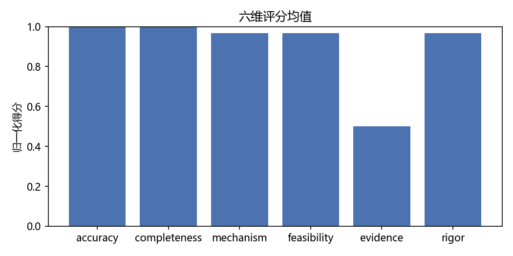
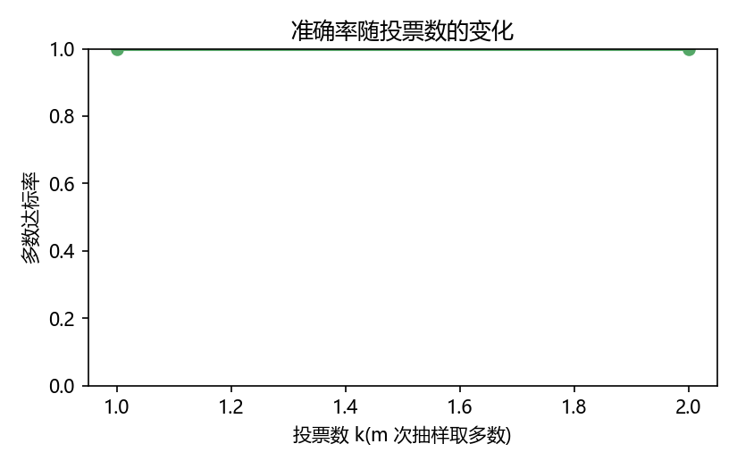
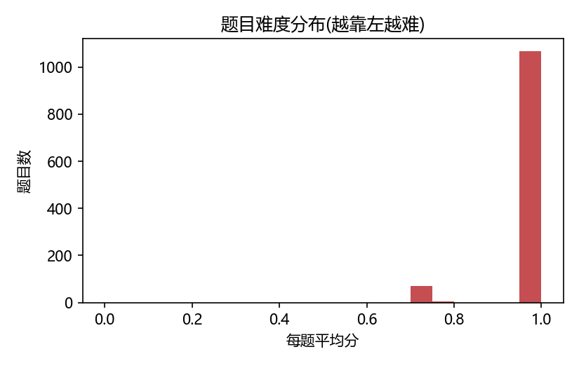
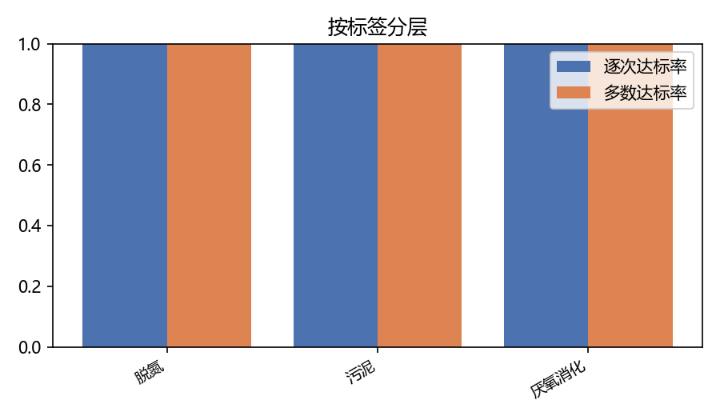
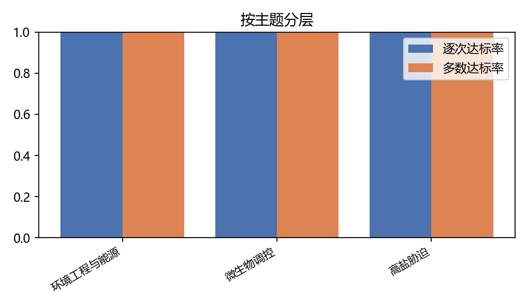
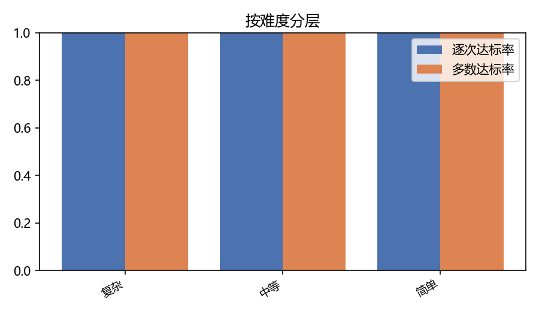
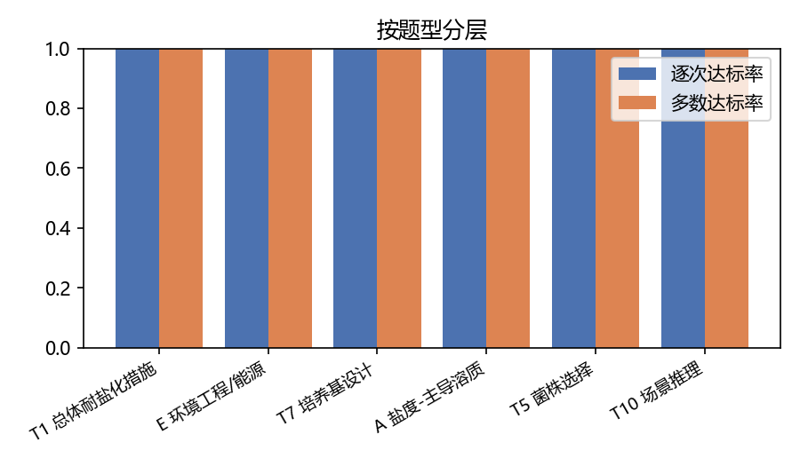
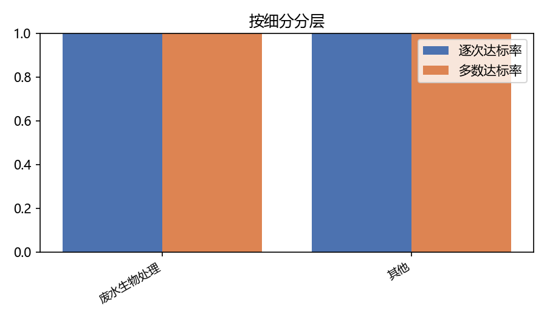
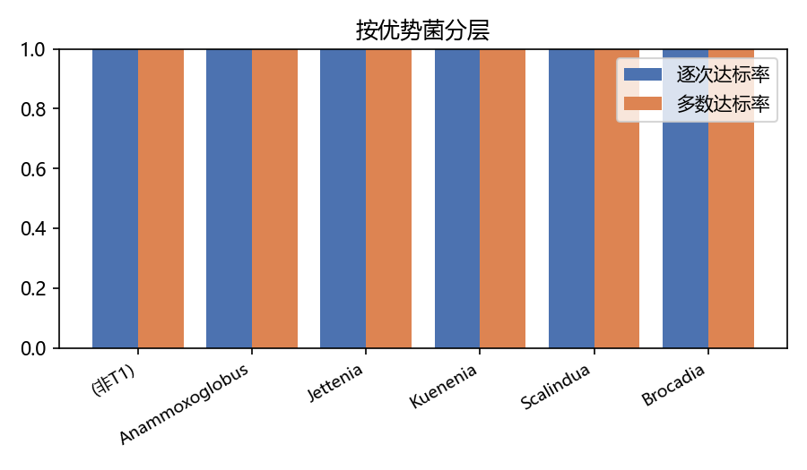
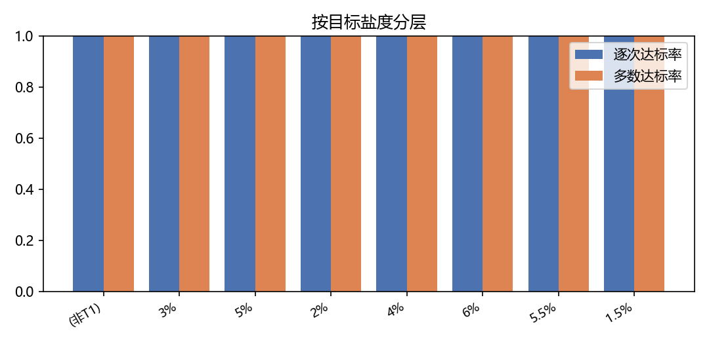
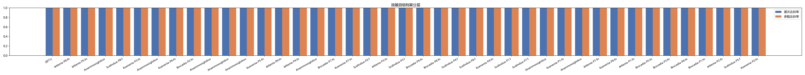
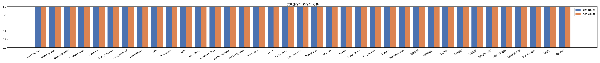
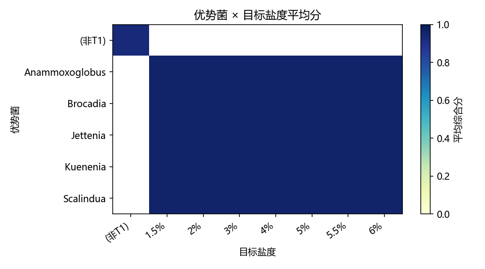