# WWBench 评测报告

生成时间:2026-09-24T23:50:27

## 1. 题库概览

- 题目数:1142,打分要点总数:4644(平均 4.07/题)
- 难度分布:{'复杂': 637, '中等': 441, '简单': 64}
- 题型分布:{'T1 总体耐盐化措施': 442, 'E 环境工程/能源': 223, 'T7 培养基设计': 143, 'A 盐度-主导溶质': 123, 'T5 菌株选择': 116, 'T10 场景推理': 95}
- 因子设计轴(题面解析):优势菌 {'(非T1)': 700, 'Anammoxoglobus': 103, 'Jettenia': 98, 'Kuenenia': 82, 'Scalindua': 81, 'Brocadia': 78};盐度区间 {'(非T1)': 700, '1%→3%': 46, '1%→5%': 42, '2%→4%': 41, '0.5%→3%': 40, '0.5%→2%': 38, '1%→2%': 38, '1.5%→5.5%': 35, '2.5%→5%': 35, '3%→6%': 34, '2%→6%': 33, '0.5%→1.5%': 32, '1.5%→4%': 28}

## 2. 运行配置

- 求解模型:`oracle`,复跑次数:2,上下文模式:closed
- 评分器:`heuristic`,通过阈值:0.6

## 3. 总体指标

- 评测覆盖:期望 1142 题,实际评测 1142 题,缺失 0 题,未知题号 0 个

| 指标 | 值 |
|---|---|
| 平均综合分 | 0.5251 |
| 逐次达标率 (accuracy) | 0.0342 |
| accuracy Wilson 95% CI | {'low': 0.0274, 'high': 0.0424} |
| 多数达标率 (stable, majority-vote 口径) | 0.0342 |
| stable Wilson 95% CI | {'low': 0.0251, 'high': 0.0463} |
| 拒答率 | 0.0 |
| 非拒答作答平均分 (precision 口径) | 0.5251 |
| 要点覆盖率 | 0.5763 |
| 六维归一分 | 0.474 |
| 数值召回(容差校验5%内) | 0.5847 |

六维明细:
- accuracy: 0.4956
- completeness: 0.4956
- mechanism: 0.4755
- feasibility: 0.4785
- evidence: 0.4229
- rigor: 0.4755

## 按标签分层

| 标签     |   题数 |   平均分 |   逐次达标率 |   多数达标率 |   拒答率 |
|:---------|-------:|---------:|-------------:|-------------:|---------:|
| 脱氮     |   1026 |   0.5207 |        0.038 |        0.038 |        0 |
| 污泥     |     80 |   0.5765 |        0     |        0     |        0 |
| 厌氧消化 |     36 |   0.5355 |        0     |        0     |        0 |

## 按主题分层

| 主题           |   题数 |   平均分 |   逐次达标率 |   多数达标率 |   拒答率 |
|:---------------|-------:|---------:|-------------:|-------------:|---------:|
| 环境工程与能源 |    757 |   0.5135 |       0.0423 |       0.0423 |        0 |
| 微生物调控     |    262 |   0.5316 |       0.0267 |       0.0267 |        0 |
| 高盐胁迫       |    123 |   0.5824 |       0      |       0      |        0 |

## 按难度分层

| 难度   |   题数 |   平均分 |   逐次达标率 |   多数达标率 |   拒答率 |
|:-------|-------:|---------:|-------------:|-------------:|---------:|
| 复杂   |    637 |   0.5144 |       0.0518 |       0.0518 |        0 |
| 中等   |    441 |   0.5323 |       0.0136 |       0.0136 |        0 |
| 简单   |     64 |   0.5815 |       0      |       0      |        0 |

## 按题型分层

| 题型              |   题数 |   平均分 |   逐次达标率 |   多数达标率 |   拒答率 |
|:------------------|-------:|---------:|-------------:|-------------:|---------:|
| T1 总体耐盐化措施 |    442 |   0.5272 |       0.0385 |       0.0385 |        0 |
| E 环境工程/能源   |    223 |   0.5284 |       0      |       0      |        0 |
| T7 培养基设计     |    143 |   0.4933 |       0.042  |       0.042  |        0 |
| A 盐度-主导溶质   |    123 |   0.5824 |       0      |       0      |        0 |
| T5 菌株选择       |    116 |   0.5758 |       0      |       0      |        0 |
| T10 场景推理      |     95 |   0.4191 |       0.1684 |       0.1684 |        0 |

## 按细分分层

| 细分         |   题数 |   平均分 |   逐次达标率 |   多数达标率 |   拒答率 |
|:-------------|-------:|---------:|-------------:|-------------:|---------:|
| 废水生物处理 |   1140 |   0.525  |       0.0342 |       0.0342 |        0 |
| 其他         |      2 |   0.5833 |       0      |       0      |        0 |

## 按优势菌分层

| 优势菌         |   题数 |   平均分 |   逐次达标率 |   多数达标率 |   拒答率 |
|:---------------|-------:|---------:|-------------:|-------------:|---------:|
| (非T1)         |    700 |   0.5237 |       0.0314 |       0.0314 |        0 |
| Anammoxoglobus |    103 |   0.5296 |       0.0388 |       0.0388 |        0 |
| Jettenia       |     98 |   0.5195 |       0.0306 |       0.0306 |        0 |
| Kuenenia       |     82 |   0.5199 |       0.0244 |       0.0244 |        0 |
| Scalindua      |     81 |   0.5318 |       0.0247 |       0.0247 |        0 |
| Brocadia       |     78 |   0.5369 |       0.0769 |       0.0769 |        0 |

## 按目标盐度分层

| 目标盐度   |   题数 |   平均分 |   逐次达标率 |   多数达标率 |   拒答率 |
|:-----------|-------:|---------:|-------------:|-------------:|---------:|
| (非T1)     |    700 |   0.5237 |       0.0314 |       0.0314 |        0 |
| 3%         |     86 |   0.5256 |       0.0465 |       0.0465 |        0 |
| 5%         |     77 |   0.5393 |       0.0519 |       0.0519 |        0 |
| 2%         |     76 |   0.5317 |       0.0526 |       0.0526 |        0 |
| 4%         |     69 |   0.536  |       0.058  |       0.058  |        0 |
| 6%         |     67 |   0.5147 |       0.0149 |       0.0149 |        0 |
| 5.5%       |     35 |   0.5055 |       0      |       0      |        0 |
| 1.5%       |     32 |   0.5234 |       0      |       0      |        0 |

## 按基因组档案分层

| 基因组档案            |   题数 |   平均分 |   逐次达标率 |   多数达标率 |   拒答率 |
|:----------------------|-------:|---------:|-------------:|-------------:|---------:|
| (非T1)                |    700 |   0.5237 |       0.0314 |       0.0314 |        0 |
| Jettenia-P8.fna       |     19 |   0.5789 |       0.1579 |       0.1579 |        0 |
| Jettenia-P5.fna       |     19 |   0.4232 |       0      |       0      |        0 |
| Anammoxoglobus-P4.fna |     17 |   0.55   |       0      |       0      |        0 |
| Scalindua-P8.fna      |     15 |   0.55   |       0      |       0      |        0 |
| Kuenenia-P3.fna       |     14 |   0.5762 |       0.1429 |       0.1429 |        0 |
| Anammoxoglobus-P7.fna |     14 |   0.5631 |       0.0714 |       0.0714 |        0 |
| Kuenenia-P6.fna       |     14 |   0.55   |       0      |       0      |        0 |
| Brocadia-P2.fna       |     14 |   0.5631 |       0.0714 |       0.0714 |        0 |
| Anammoxoglobus-P2.fna |     14 |   0.5893 |       0.2143 |       0.2143 |        0 |
| Anammoxoglobus-P3.fna |     14 |   0.55   |       0      |       0      |        0 |
| Anammoxoglobus-P1.fna |     13 |   0.4083 |       0      |       0      |        0 |
| Kuenenia-P5.fna       |     13 |   0.4083 |       0      |       0      |        0 |
| Jettenia-P6.fna       |     13 |   0.55   |       0      |       0      |        0 |
| Jettenia-P4.fna       |     13 |   0.55   |       0      |       0      |        0 |
| Anammoxoglobus-P8.fna |     13 |   0.55   |       0      |       0      |        0 |
| Brocadia-P7.fna       |     12 |   0.5958 |       0.25   |       0.25   |        0 |
| Kuenenia-P7.fna       |     12 |   0.55   |       0      |       0      |        0 |
| Scalindua-P2.fna      |     11 |   0.55   |       0      |       0      |        0 |
| Jettenia-P3.fna       |     11 |   0.55   |       0      |       0      |        0 |
| Scalindua-P3.fna      |     11 |   0.55   |       0      |       0      |        0 |
| Brocadia-P4.fna       |     11 |   0.5833 |       0.1818 |       0.1818 |        0 |
| Brocadia-P8.fna       |     11 |   0.55   |       0      |       0      |        0 |
| Scalindua-P4.fna      |     10 |   0.5867 |       0.2    |       0.2    |        0 |
| Scalindua-P6.fna      |     10 |   0.55   |       0      |       0      |        0 |
| Kuenenia-P4.fna       |      9 |   0.55   |       0      |       0      |        0 |
| Scalindua-P1.fna      |      9 |   0.4398 |       0      |       0      |        0 |
| Scalindua-P7.fna      |      9 |   0.55   |       0      |       0      |        0 |
| Anammoxoglobus-P5.fna |      9 |   0.4398 |       0      |       0      |        0 |
| Kuenenia-P1.fna       |      9 |   0.4398 |       0      |       0      |        0 |
| Anammoxoglobus-P6.fna |      9 |   0.55   |       0      |       0      |        0 |
| Jettenia-P7.fna       |      9 |   0.55   |       0      |       0      |        0 |
| Kuenenia-P8.fna       |      8 |   0.55   |       0      |       0      |        0 |
| Jettenia-P1.fna       |      8 |   0.4083 |       0      |       0      |        0 |
| Brocadia-P5.fna       |      8 |   0.4083 |       0      |       0      |        0 |
| Brocadia-P3.fna       |      8 |   0.55   |       0      |       0      |        0 |
| Brocadia-P6.fna       |      7 |   0.55   |       0      |       0      |        0 |
| Brocadia-P1.fna       |      7 |   0.4083 |       0      |       0      |        0 |
| Jettenia-P2.fna       |      6 |   0.55   |       0      |       0      |        0 |
| Scalindua-P5.fna      |      6 |   0.4083 |       0      |       0      |        0 |
| Kuenenia-P2.fna       |      3 |   0.55   |       0      |       0      |        0 |

## 按类别标签(多标签)分层

| 类别标签                      |   题数 |   平均分 |   逐次达标率 |   多数达标率 |   拒答率 |
|:------------------------------|-------:|---------:|-------------:|-------------:|---------:|
| Activated sludge              |     34 |   0.5833 |       0      |       0      |        0 |
| Aerobic granular sludge       |      2 |   0.3959 |       0      |       0      |        0 |
| Ammonia inhibition            |     16 |   0.5022 |       0      |       0      |        0 |
| Anaerobic digestion           |     35 |   0.5341 |       0      |       0      |        0 |
| Anammox                       |    610 |   0.5343 |       0.0393 |       0.0393 |        0 |
| Bioaugmentation               |    618 |   0.5357 |       0.0275 |       0.0275 |        0 |
| Compatible solutes            |    922 |   0.5312 |       0.0423 |       0.0423 |        0 |
| Denitrification               |     19 |   0.5662 |       0      |       0      |        0 |
| EPS                           |     37 |   0.5732 |       0      |       0      |        0 |
| Halomonas                     |     22 |   0.5    |       0      |       0      |        0 |
| MBR                           |     18 |   0.5787 |       0      |       0      |        0 |
| Mainstream                    |      1 |   0.5    |       0      |       0      |        0 |
| Membrane fouling              |     18 |   0.5787 |       0      |       0      |        0 |
| Methanogenesis                |     18 |   0.5815 |       0      |       0      |        0 |
| N2O mitigation                |     18 |   0.5671 |       0      |       0      |        0 |
| Nitrification                 |     42 |   0.5266 |       0      |       0      |        0 |
| PN/A                          |     66 |   0.4527 |       0      |       0      |        0 |
| Partial denitrification       |     24 |   0.4875 |       0      |       0      |        0 |
| SRB competition               |     15 |   0.5    |       0      |       0      |        0 |
| Salinity acclimation          |    699 |   0.5133 |       0.0558 |       0.0558 |        0 |
| Salt shock                    |     33 |   0.5962 |       0.4545 |       0.4545 |        0 |
| Sulfate                       |     15 |   0.5    |       0      |       0      |        0 |
| Sulfur-driven denitrification |     25 |   0.4893 |       0      |       0      |        0 |
| Temperature                   |     16 |   0.4978 |       0      |       0      |        0 |
| Thauera                       |     23 |   0.4909 |       0      |       0      |        0 |
| Wastewater treatment          |     35 |   0.5619 |       0      |       0      |        0 |
| 场景推理                      |     95 |   0.4191 |       0.1684 |       0.1684 |        0 |
| 培养基设计                    |    143 |   0.4933 |       0.042  |       0.042  |        0 |
| 工艺决策                      |     15 |   0.125  |       0      |       0      |        0 |
| 总体策略                      |    442 |   0.5272 |       0.0385 |       0.0385 |        0 |
| 污泥处置                      |     16 |   0.5833 |       0      |       0      |        0 |
| 环境工程-污泥                 |      6 |   0.493  |       0      |       0      |        0 |
| 环境工程-能源                 |     19 |   0.561  |       0      |       0      |        0 |
| 环境工程-脱氮                 |     70 |   0.4323 |       0      |       0      |        0 |
| 盐度-主导溶质                 |    123 |   0.5824 |       0      |       0      |        0 |
| 经济性                        |     17 |   0.125  |       0      |       0      |        0 |
| 菌株选择                      |    116 |   0.5758 |       0      |       0      |        0 |

## 优势菌 × 目标盐度交互

| 优势菌         | 目标盐度   |   题数 |   平均分 |   逐次达标率 |   多数达标率 |
|:---------------|:-----------|-------:|---------:|-------------:|-------------:|
| (非T1)         | (非T1)     |    700 |   0.5237 |       0.0314 |       0.0314 |
| Anammoxoglobus | 1.5%       |      7 |   0.55   |       0      |       0      |
| Anammoxoglobus | 2%         |     19 |   0.5276 |       0      |       0      |
| Anammoxoglobus | 3%         |     19 |   0.5224 |       0.0526 |       0.0526 |
| Anammoxoglobus | 4%         |     13 |   0.5455 |       0.1538 |       0.1538 |
| Anammoxoglobus | 5%         |     25 |   0.5403 |       0.04   |       0.04   |
| Anammoxoglobus | 5.5%       |      6 |   0.5264 |       0      |       0      |
| Anammoxoglobus | 6%         |     14 |   0.4994 |       0      |       0      |
| Brocadia       | 1.5%       |      6 |   0.5264 |       0      |       0      |
| Brocadia       | 2%         |     12 |   0.5687 |       0.1667 |       0.1667 |
| Brocadia       | 3%         |     17 |   0.5191 |       0.0588 |       0.0588 |
| Brocadia       | 4%         |      9 |   0.5546 |       0.1111 |       0.1111 |
| Brocadia       | 5%         |     11 |   0.5704 |       0.1818 |       0.1818 |
| Brocadia       | 5.5%       |     12 |   0.5028 |       0      |       0      |
| Brocadia       | 6%         |     11 |   0.5242 |       0      |       0      |
| Jettenia       | 1.5%       |      5 |   0.55   |       0      |       0      |
| Jettenia       | 2%         |     10 |   0.54   |       0.1    |       0.1    |
| Jettenia       | 3%         |     17 |   0.5191 |       0.0588 |       0.0588 |
| Jettenia       | 4%         |     21 |   0.5028 |       0      |       0      |
| Jettenia       | 5%         |     18 |   0.5287 |       0.0556 |       0.0556 |
| Jettenia       | 5.5%       |     10 |   0.4933 |       0      |       0      |
| Jettenia       | 6%         |     17 |   0.525  |       0      |       0      |
| Kuenenia       | 1.5%       |      8 |   0.4792 |       0      |       0      |
| Kuenenia       | 2%         |     24 |   0.5146 |       0      |       0      |
| Kuenenia       | 3%         |     16 |   0.5323 |       0      |       0      |
| Kuenenia       | 4%         |      9 |   0.5704 |       0.1111 |       0.1111 |
| Kuenenia       | 5%         |      9 |   0.5185 |       0      |       0      |
| Kuenenia       | 5.5%       |      4 |   0.5146 |       0      |       0      |
| Kuenenia       | 6%         |     12 |   0.5062 |       0.0833 |       0.0833 |
| Scalindua      | 1.5%       |      6 |   0.5264 |       0      |       0      |
| Scalindua      | 2%         |     11 |   0.528  |       0.0909 |       0.0909 |
| Scalindua      | 3%         |     17 |   0.5358 |       0.0588 |       0.0588 |
| Scalindua      | 4%         |     17 |   0.5417 |       0      |       0      |
| Scalindua      | 5%         |     14 |   0.5399 |       0      |       0      |
| Scalindua      | 5.5%       |      3 |   0.5028 |       0      |       0      |
| Scalindua      | 6%         |     13 |   0.5173 |       0      |       0      |

## 最难题目 Top10

| question_id   |   平均分 |   pass_rate |
|:--------------|---------:|------------:|
| q-203         |    0.1   |           0 |
| q-207         |    0.125 |           0 |
| q-674         |    0.125 |           0 |
| q-678         |    0.125 |           0 |
| q-680         |    0.125 |           0 |
| q-684         |    0.125 |           0 |
| q-686         |    0.125 |           0 |
| q-690         |    0.125 |           0 |
| q-692         |    0.125 |           0 |
| q-696         |    0.125 |           0 |

## 最易题目 Top10

| question_id   |   平均分 |   pass_rate |
|:--------------|---------:|------------:|
| q-105         |   0.9583 |           1 |
| q-125         |   0.7333 |           1 |
| q-126         |   0.7333 |           1 |
| q-127         |   0.7333 |           1 |
| q-128         |   0.7333 |           1 |
| q-129         |   0.7333 |           1 |
| q-130         |   0.7333 |           1 |
| q-172         |   0.7333 |           1 |
| q-174         |   0.7333 |           1 |
| q-177         |   0.7333 |           1 |

## 图表

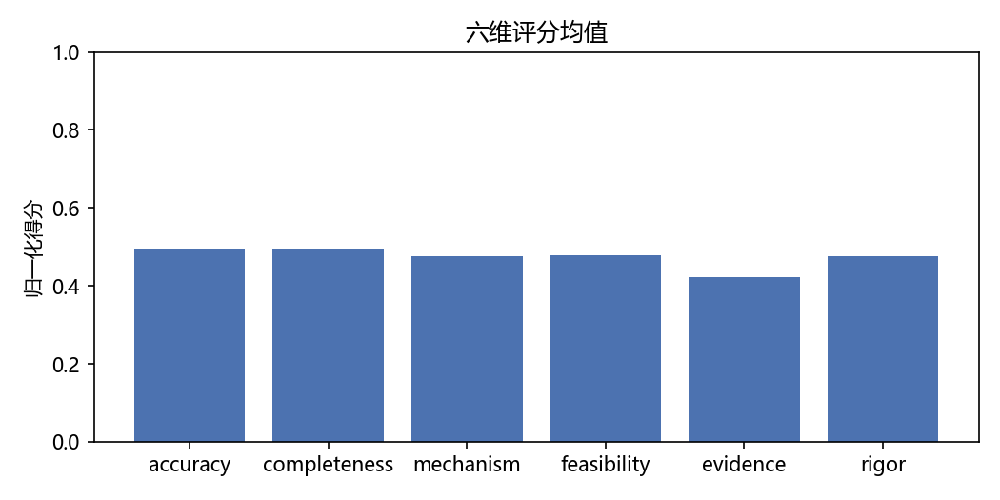
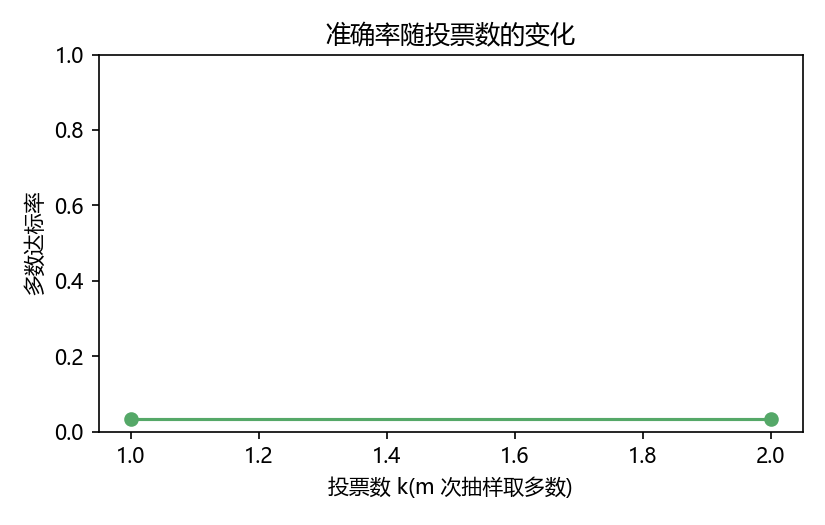
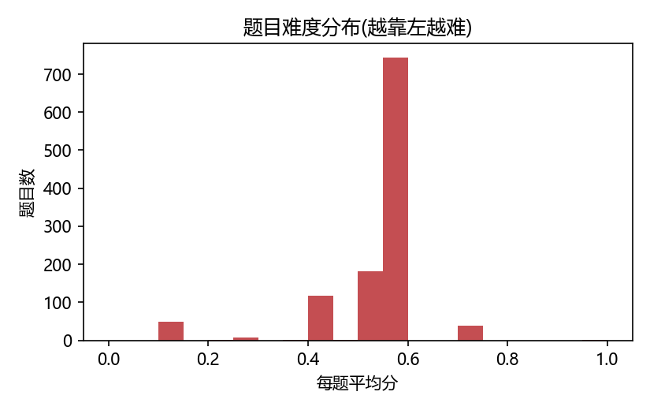
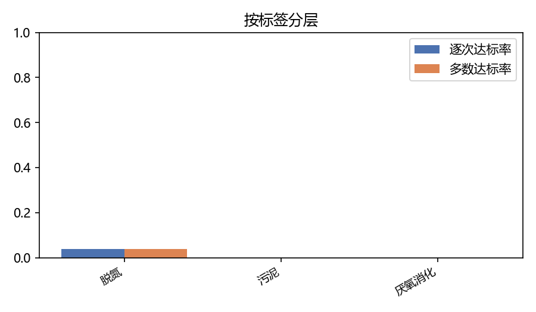
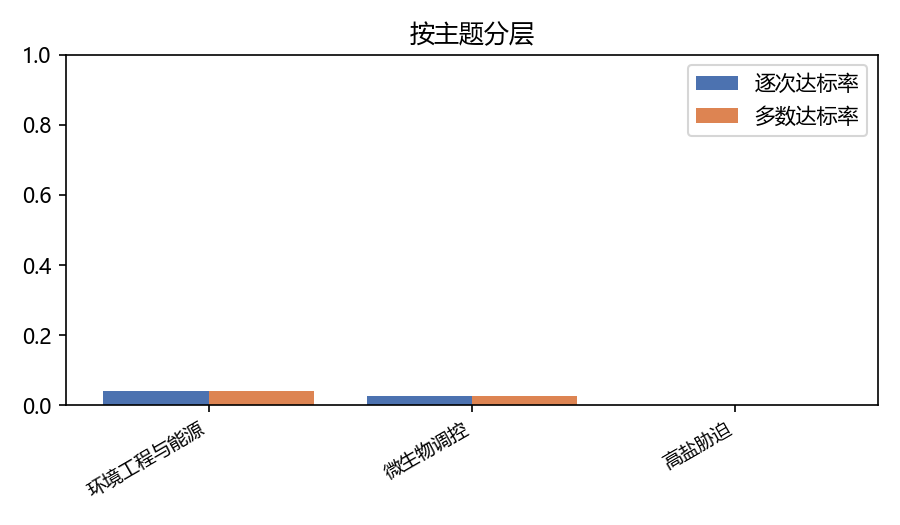
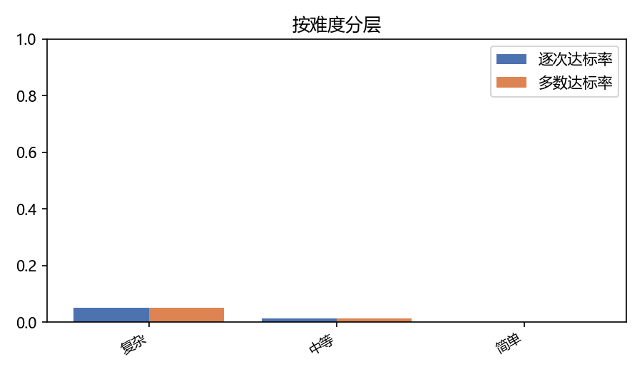
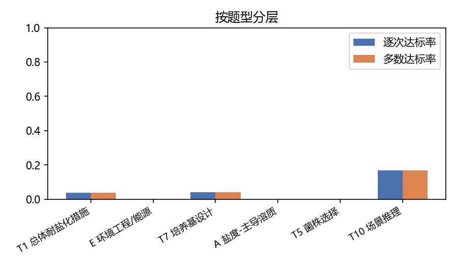
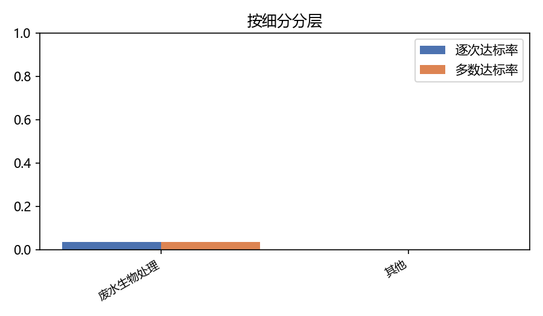
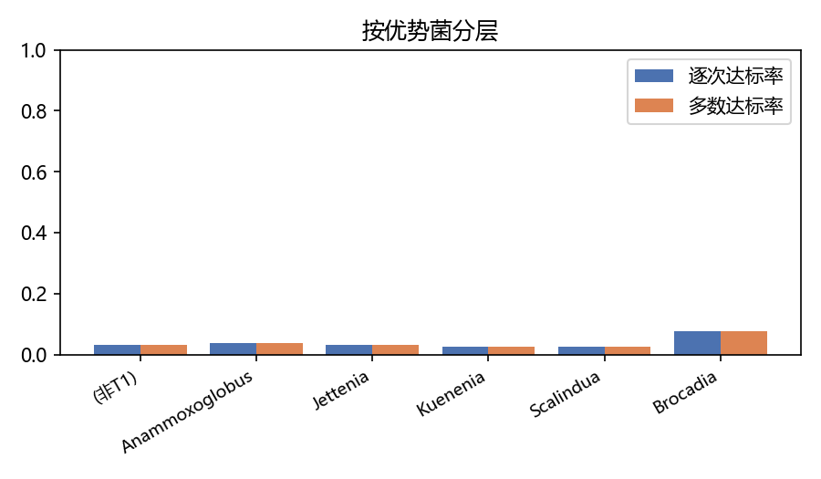
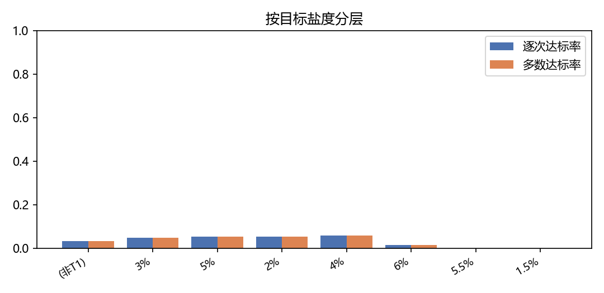
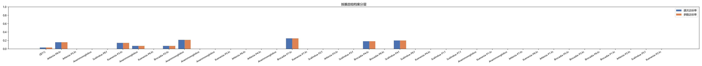
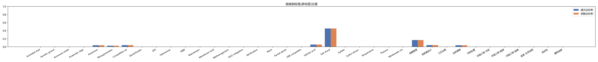
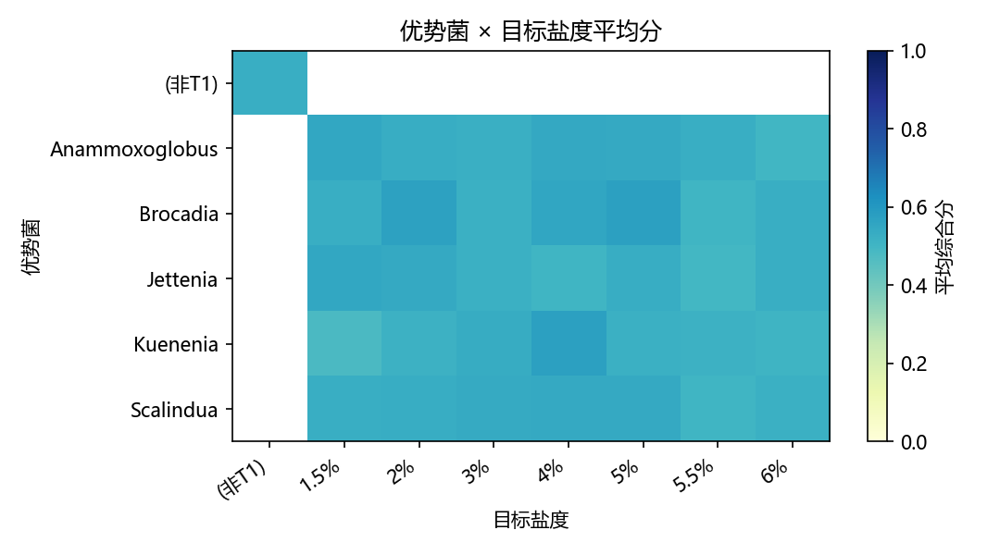